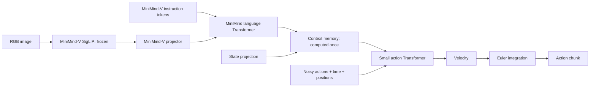

# MiniMind-A

MiniMind-V의 **SigLIP → projector → 언어 Transformer**에 작은 행동 Transformer를
붙인 교육용 Vision-Language-Action(VLA) 모델입니다. 이미지·지시문·현재 상태로부터
연속값 행동 청크 `[B, H, A]`를 예측합니다.

[SmolVLA](https://github.com/huggingface/lerobot/tree/main/src/lerobot/policies/smolvla)의
행동 expert, flow matching, 청크 예측을 참고했습니다. 원본의 레이어별 expert 연결 대신
VLM의 **앞쪽 절반 레이어**를 거친 hidden states에 표준 cross-attention을 적용했습니다.

**시각 인코더는 MiniMind-V에서 사용하는 SigLIP만 사용합니다.** 별도 Conv2d 인코더와
byte tokenizer는 제거했습니다. 지시문도 MiniMind-V의 6400-token tokenizer를 사용합니다.

## 수업에서 읽는 순서

먼저 [model/model_vla.py](model/model_vla.py)의 아래 함수들을 읽으세요.
`B`는 배치 크기, `H`는 미래 행동 개수, `A`는 행동 하나의 차원입니다.

| 순서 | 함수 | 역할 |
|---|---|---|
| 1 | `flow_inputs` | 노이즈와 정답을 보간하고 목표 속도 `a-ε` 계산 |
| 2 | `velocity` | 현재 청크·생성 시간·문맥에서 변화율 `[B,H,A]` 예측 |
| 3 | `flow_loss` | 임의 시간 하나에서 예측한 속도와 목표 속도의 MSE 계산 |
| 4 | `integrate_actions` | 속도를 반복 예측하며 Euler 적분으로 행동 생성 |
| 5 | `encode_context` | 이미지·지시문을 VLM으로 처리하고 상태를 결합 |
| 6 | `forward` / `sample_actions` | 각각 학습과 추론의 전체 흐름 연결 |

```text
학습: forward → encode_context → flow_loss → velocity → loss
추론: sample_actions → encode_context → 노이즈 생성 → integrate_actions
                                                     └ velocity 반복 → 행동 청크
```

그다음 `dataset/vla_dataset.py`에서 입력 shape와 패딩을,
`train_vla.py`에서 역전파를, `eval_vla.py`에서 저장된 모델의 추론을 확인합니다.
체크포인트 입출력은 `model_vla.py` 뒤쪽에 있습니다.
`model_minimind.py`와 `model_vlm.py`는 출처를 보존한 MiniMind-V 기반 코드입니다.
`scripts/runpod_so101/`은 고정 VLM 캐시·클라우드 학습·시뮬레이터 실행을 위한 확장 예제입니다.
기본 학습·추론을 이해한 뒤 읽으면 됩니다.

## SigLIP 준비

MiniMind-V의 `google/siglip2-base-patch32-256` 가중치와 processor를 담은 로컬 폴더가 필요합니다.
새 인코더를 학습하거나 같은 가중치를 다시 다운로드하지 않습니다.

이 작업 공간의 `model/siglip2-base-p32-256-ve`는 기존 학습 산출물인
`../outputs/minimind-v/sharegpt4v-20261020/vision_encoder`를 가리키는 상대 심볼릭 링크입니다.
가중치를 복제하지 않고 기존 파일을 그대로 읽습니다.

다른 머신에서는 해당 위치에 SigLIP 폴더를 준비하거나 학습·추론 명령에
`--vision-model-path /path/to/vision_encoder`를 지정하세요. 필요한 파일은
`config.json`, `model.safetensors`, `preprocessor_config.json`입니다.
비전 폴더가 없으면 오류를 내며 다른 인코더로 대체하지 않습니다.

## CPU 실행 예제

Python 3.11 환경에서:

```bash
cd minimind-a
python3 -m venv .venv
source .venv/bin/activate
pip install -r requirements-dev.txt

python scripts/make_toy_data.py --output data/siglip_smoke --count 8
python train_vla.py --data data/siglip_smoke/train.jsonl \
  --val-data data/siglip_smoke/val.jsonl --epochs 1 --batch-size 2 \
  --output out/siglip_smoke
python eval_vla.py --checkpoint out/siglip_smoke/vla.pt \
  --data data/siglip_smoke/val.jsonl --output out/siglip_smoke/prediction.json
python -m pytest -q
```

기본 설정은 **실제 사전학습 SigLIP + 작은 MiniMind 언어 Transformer(64 hidden, 원본 2개 중 앞쪽 1개 레이어)**입니다.
언어 Transformer·projector·행동 expert는 무작위 초기화하고, SigLIP은 항상 고정합니다.
합성 이미지를 processor가 256×256으로 변환하고, SigLIP에서 64개 768차원 토큰을 얻습니다.
이 예제는 실행·역전파·저장·복원을 확인하는 smoke test이며 좋은 행동 정책을 학습하는 예제가 아닙니다.

합성 장면에는 빨간 목표·파란 목표·흰색 현재 위치가 있습니다.
지시문은 `move to the red target` 또는 `move to the blue target`입니다.
상태는 현재 `(x,y)`, 정답 행동은 목표까지 보간한 미래 절대 위치 setpoint 8개입니다.
좌표는 `[-1,1]`이며 속도나 위치 변화량이 아닙니다.

## 기존 MiniMind-V 언어·projector 가중치도 재사용

기존 학습된 VLM 가중치를 기반으로 쓰려면 `configs/minimind_v_768.json`을 사용합니다.
이 설정은 원본 768 hidden, 8 layers, 6400 vocab을 나타냅니다.
그중 **앞쪽 4개 언어 레이어만** 가져와 VLM을 고정하고 새 행동부를 학습합니다.
현재 작업 공간에서는 다음처럼 실행할 수 있습니다.

```bash
python train_vla.py --config configs/minimind_v_768.json \
  --vlm-checkpoint ../outputs/minimind-v/sharegpt4v-20261020/sft_vlm_768.pth \
  --data /path/to/robot/train.jsonl --val-data /path/to/robot/val.jsonl \
  --epochs 10 --device cuda --output out/robot

python eval_vla.py --checkpoint out/robot/vla.pt \
  --data /path/to/robot/val.jsonl --device cuda
```

로봇 데이터에 맞게 JSON의 `state_dim`, `action_dim`, `chunk_size`를 바꾸세요.
VLM의 hidden/layer/head/vocab 크기는 로드할 원본 가중치와 같아야 합니다.
`vlm_config.num_hidden_layers`는 **원본 레이어 수**입니다. 8→4로 줄여 적지 마세요.
실제 모델은 `max(1, num_hidden_layers // 2)`개를 구성합니다.
뒤쪽 레이어는 생성·실행·저장하지 않으며, 원본 가중치를 불러올 때 해당 부분만 제외합니다.
`freeze_vlm=false`이면 언어모델·projector도 학습하며, 이때도 SigLIP은 고정합니다.
기존 VLM 가중치 없이 언어부를 무작위 초기화할 때는 `freeze_vlm=false`로 두세요.
`train_vla.py`는 `freeze_vlm=true`인데 `--vlm-checkpoint`가 없으면
모델을 로드하기 전에 오류를 냅니다. 무작위 언어부·projector가 고정된 채 학습되는 실수를 방지합니다.

## 구조와 읽는 순서



| 파일 | 내용 |
|---|---|
| `model/model_vla.py` | SigLIP VLM 연결, 행동 expert, flow loss, Euler 추론 |
| `model/model_vlm.py` | 수정 없이 복사한 원본 MiniMind-V |
| `model/model_minimind.py` | 수정 없이 복사한 원본 MiniMind Transformer |
| `dataset/vla_dataset.py` | SigLIP processor, MiniMind tokenizer, 배치·패딩 |
| `train_vla.py` | forward → backward → optimizer, 검증, 저장 |
| `eval_vla.py` | 실제 이미지에서 청크 추론 |
| `configs/minimind_v_768.json` | 기존 학습 VLM 재사용 설정 |

`EducationalVLM`은 원본의 SigLIP·projector와 언어 레이어의 앞쪽 절반을 사용합니다.
남은 마지막 레이어 출력에 기존 final norm을 적용하며 어휘 logits 계산은 생략합니다.
이미지 인코더와 hidden 차원은 줄이지 않습니다.
이미지 토큰은 지시문 앞에 연속으로 배치하고, 상태 투영을 문맥 뒤 한 토큰으로 붙입니다.
행동 위치에는 학습 가능한 position embedding을 더합니다. 청크의 행동끼리는 양방향 attention을,
문맥에는 cross-attention을 적용합니다. 이미지·언어 문맥은 청크당 한 번 계산합니다.

기본 shape: processor 출력 `[B,3,256,256]`, SigLIP 출력 `[B,64,768]`,
언어 문맥 `[B,L,64]`, 상태 `[B,2]`, 행동 `[B,8,2]`입니다.
768 VLM 설정은 언어 문맥 `[B,L,768]`입니다.

## Flow matching

정답 청크 `a`, 표준정규 노이즈 `ε`, uniform 시간 `t ∈ [0,1]`에 대해:

```text
x_t = (1 - t) ε + t a
목표 속도 = a - ε
loss = 유효 행동 원소의 MSE(vθ(x_t, t, 이미지·지시·상태), a - ε)
```

추론은 `x_0=ε`에서 시작해 `x ← x + vθ(x,t)/steps`를 반복합니다.
시간 convention은 **0=노이즈, 1=데이터**입니다.

**생성 시간 `t`와 로봇 실행 순서 `H`를 구분하세요.** `time`은 `[B]`이며,
한 샘플의 청크 전체에 같은 생성 시간을 적용합니다. `velocity`는 로봇의 물리적
속도가 아니라 **생성 시간에 따른 행동 청크의 변화율**입니다.
청크 안의 행동 순서는 `action_position`이 표현합니다.

학습에서는 `t`를 샘플링해 한 번만 속도를 예측합니다. 정답 `a`와 노이즈 `ε`는
보간 입력과 목표를 만드는 데 쓰이며, 속도 신경망에는 `x_t`, `t`, 문맥만 전달합니다.
개별 학습 쌍의 목표 속도는 일정하지만, 모델이 배우는 속도장은 위치·시간·문맥에 따라
달라집니다. 따라서 생성 경로가 반드시 직선인 것은 아닙니다.

추론에서는 정답 없이 아래 반복문으로 **전체 청크를 동시에** 갱신합니다.
실제 구현은 `integrate_actions`에 있으며, 기본 적분 횟수는 10입니다.

```python
actions = noise
dt = 1.0 / steps
for step in range(steps):
    time = torch.full((actions.size(0),), step / steps, device=actions.device)
    velocity = self.velocity(memory, valid, actions, time)
    actions = actions + dt * velocity
```

`steps`는 수치 적분 횟수이고 `chunk_size`는 반환할 행동 개수입니다.
10번 적분한다고 행동이 10개 생성되는 것은 아닙니다. Euler 적분에는 근사 오차가 있으며,
flow loss의 감소가 로봇 작업 성공률을 직접 보장하지는 않습니다.

텍스트 패딩은 VLM·cross-attention에서 제외하고, 행동 패딩은 expert key/value와 loss에서 제외합니다.
손실은 유효한 행동 원소 수로 나누며, 제곱 오차는 FP32에서 계산합니다.
추론은 항상 전체 `chunk_size`를 반환합니다.
짧은 청크의 학습과 전체 청크의 추론은 행동 attention 범위가 다릅니다.
첫 실습에는 toy 데이터처럼 패딩 없는 고정 길이 청크를 권장합니다.

RunPod 학습도 `project_context`, `flow_loss`, `integrate_actions`를 재사용합니다.
VLM 출력만 캐시하고, 학습하는 문맥 투영과 상태 투영은 매번 계산합니다.

## 데이터와 저장

JSONL 한 줄은 관측 한 개와 그 시점부터의 미래 행동 청크입니다. 이미지 경로는 JSONL 폴더 기준입니다.

```json
{"image":"images/00000.png","instruction":"move to the red target","state":[0.0,0.1],"actions":[[0.1,0.2],[0.2,0.3]]}
```

상태 길이는 `state_dim`, 각 행동 길이는 `action_dim`이어야 합니다.
행동 시점 수는 `1..chunk_size`이며 짧은 청크는 패딩합니다.
추론 데이터에서는 `actions`를 생략할 수 있습니다.
지시문은 chat template를 적용한 전체 토큰 길이를 검사합니다.
이미지 토큰과 합쳐 `max_position_embeddings`를 넘으면 자동으로 자르지 않고
실제 길이와 허용 길이를 포함한 오류를 냅니다. 지시문을 줄이거나 문맥 길이 설정을 늘리세요.
실제 trajectory는 episode 단위로 train/val을 나누고 episode 경계는 패딩하세요.
실제 데이터의 상태·행동은 학습 split 통계로 미리 정규화하고 출력에 같은 역변환을 적용하세요.
자동 정규화와 하드웨어 제어는 제공하지 않습니다.

`vla.pt`는 설정과 **SigLIP을 제외한** VLA 가중치를 저장합니다.
새 체크포인트는 `format_version=2`이며, 사용한 앞쪽 언어 레이어만 포함합니다.
기존 전체 레이어로 학습한 VLA 체크포인트는 지원하지 않습니다.
기존 MiniMind-V 원본 가중치를 가져와 행동 expert를 새로 학습해야 합니다.
고정 SigLIP은 로드할 때 기존 로컬 폴더에서 다시 읽으므로 추론 머신에도 같은 비전 가중치가 필요합니다.
폴더가 이동했으면 `eval_vla.py --vision-model-path /new/path`를 사용하세요.
`history.json`은 학습·검증 loss, `prediction.json`은 생성 행동과 선택 샘플의 MSE입니다.
optimizer/RNG 저장 및 학습 재개는 생략했습니다.

## 범위와 검증

단일 카메라·단일 관측·고정 차원만 지원합니다. SmolVLA 체크포인트와 호환되지 않으며,
비동기 실행, RTC, 로봇 SDK, 다중 GPU, MoE는 생략했습니다.
기본 예제는 오프라인 학습·추론이며, SO101 시뮬레이터 rollout은 별도 확장 예제입니다.

CPU 테스트는 `python -m pytest -q`로 실행합니다. 테스트는 작은 **실제 Hugging Face SigLIP 모델**을 임시 폴더에 무작위 초기화하여 실행합니다.
별도 vision encoder 구현을 테스트에 사용하지 않습니다. 기본 실행 경로는 기존 사전학습 SigLIP을 사용합니다.
실제 가중치로 수행한 smoke test와 테스트 결과는 [docs/verification.md](docs/verification.md)에 기록합니다.
기존 tiny 인코더의 결과는 `out/legacy_tiny/`에 보존했으며 현재 구현의 결과로 사용하지 않습니다.
지시문 길이 경계·초과 거부, 고정 VLM의 체크포인트 필수 조건,
무작위 VLM 학습 및 사전학습 VLM 고정 학습의 저장·복원도 검사합니다.

Apache-2.0. 원본 파일 출처는 [NOTICE](NOTICE), [docs/provenance.json](docs/provenance.json)을 참고하세요.
