<div align="center">

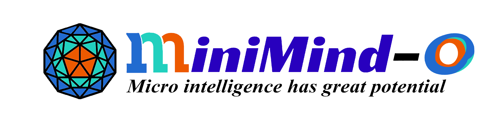

# MiniMind-O — 작은 음성·시각·언어 통합 모델 만들기

[中文](./README.md) | [English](./README_en.md) | 한국어

[기술 보고서](http://arxiv.org/abs/2605.03937) · [온라인 데모](https://modelscope.cn/studios/gongjy/MiniMind-O) · [소개 영상](https://www.bilibili.com/video/BV1V1RsBcEMX)

</div>

> 이 문서는 [영문 README](./README_en.md)를 바탕으로 주요 사용법과 기술 설명을 한국어로 재구성한 안내서입니다. 전체 재생 예제와 세부 실험 설명은 영문 원문을 참고하세요. 아래 모델 규모와 학습 시간, 평가 수치는 원문에 보고된 값입니다.

## 프로젝트 소개

MiniMind-O는 텍스트·음성·이미지를 입력받아 텍스트와 스트리밍 음성을 함께 출력하는 작은 Omni 모델입니다. [MiniMind](../minimind/README_ko.md)의 언어 모델과 [MiniMind-V](../minimind-v/README_ko.md)의 시각 확장을 바탕으로, 듣고 보고 생각하고 말하는 전체 경로를 이해하고 수정할 수 있도록 구현합니다.

학습 가능한 백본은 약 0.1B 규모이며, 핵심 알고리즘은 PyTorch로 직접 구현합니다. Thinker–Talker 이중 경로, 다중 토큰 예측(MTP), 스트리밍 음성, 발화 중 끼어들기, 준양방향 상호작용, 음성 복제와 전화 모드 WebUI를 포함합니다.

음성을 먼저 텍스트로 전사하고 LLM의 출력을 별도 TTS로 합성하는 직렬 파이프라인과 달리, 음성과 텍스트를 은닉 상태 수준에서 연결합니다. Talker가 직접 복원 가능한 Mimi 음향 코드를 생성하고, Mimi 디코더가 이를 음성으로 바꿉니다.

데이터는 빠른 입문용 `mini`와 공개 가중치 재현용 `full`로 나뉩니다. 원문의 “약 2시간”은 RTX 3090 한 장에서 mini 데이터로 SFT 경로를 실행한 측정 시간이며, full 학습이나 공개 모델의 모든 능력을 재현하는 시간을 뜻하지 않습니다.

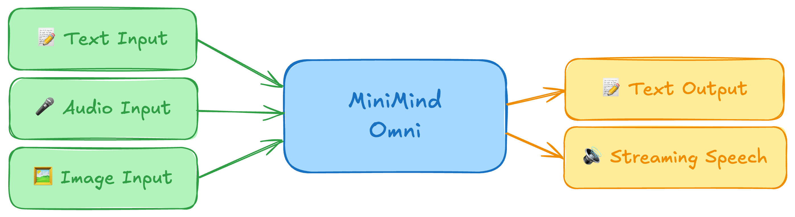

### 제공 기능

- Thinker, 독립 Talker, 오디오·비전 Projector, Mimi 코드북 인터페이스 및 MTP 오디오 헤드.
- T2A, A2A, I2T 데이터 학습과 전체 학습·Projector 단독 정렬 모드.
- 단일 GPU와 DDP 다중 GPU 학습, 체크포인트 재개.
- 내장 음성 조건과 새로운 참조 음성을 이용한 음색 제어·음성 복제.
- 명령행 추론, Gradio 화면, 스트리밍 재생, 발화 중 끼어들기와 전화 모드.
- 구조, 학습 곡선, CER/WER, 음성 유사도 및 모델 비교를 다루는 기술 보고서.

### 공개 모델

| 모델 | 백본 매개변수 규모 | 공개일 |
|---|---|---|
| minimind-3o | 약 0.1B | 2026.05.05 |
| minimind-3o-moe | 약 0.3B-A0.1B | 2026.05.05 |

첫 공개에서는 각각 115M, 312M-A115M으로 소개되었습니다. 모듈별 중복 제거 집계와 실험 구성에 따라 상세 수치는 다르며, 아래 모듈 표는 원문의 해당 집계 기준을 따릅니다.

## 빠른 시작

아래 명령은 별도 표기가 없으면 `minimind-o/`에서 실행합니다. 이 통합 작업공간에서는 기존 디렉토리로 이동하면 됩니다.

### 환경 준비

원문의 참고 환경은 Ubuntu 20.04, CUDA 12.2, Python 3.10, RTX 3090 24GB입니다. 전체 실험 장비는 GPU 8장이지만 mini 경로는 한 장에서 실행하도록 구성됩니다.

새로 저장소를 받는 경우:

```bash
git clone --depth 1 https://github.com/jingyaogong/minimind-o
cd minimind-o
pip install -r requirements.txt
```

CUDA 사용 여부:

```python
import torch
print(torch.cuda.is_available())
```

### 필수 리소스 받기

```bash
# 음성 인코더
modelscope download --model gongjy/SenseVoiceSmall --local_dir ./model/SenseVoiceSmall

# 비전 인코더
modelscope download --model gongjy/siglip2-base-p32-256-ve --local_dir ./model/siglip2-base-p32-256-ve

# 오디오 코덱
modelscope download --model gongjy/mimi --local_dir ./model/mimi

# 화자 인코더
modelscope download --model gongjy/campplus --local_dir ./model/campplus

# Omni 학습의 초기 언어 백본
modelscope download --model gongjy/minimind-3o-pytorch llm_768.pth --local_dir ./out
```

[ModelScope 모음](https://modelscope.cn/collections/gongjy/MiniMind-O) 또는 [Hugging Face 모음](https://huggingface.co/collections/jingyaogong/minimind-o)에서도 받을 수 있습니다. Git으로 큰 파일을 내려받는 경우 LFS가 필요합니다.

```text
minimind-o/
├── model/
│   ├── SenseVoiceSmall/
│   ├── siglip2-base-p32-256-ve/
│   ├── mimi/
│   └── campplus/
├── out/
│   └── llm_768.pth
├── dataset/
└── trainer/
```

### 공개 가중치로 추론

```bash
modelscope download --model gongjy/minimind-3o-pytorch --local_dir ./out
python eval_omni.py --load_from model --weight sft_omni
```

Transformers 형식 모델을 사용할 수도 있습니다.

```bash
git clone https://huggingface.co/jingyaogong/minimind-3o
python eval_omni.py --load_from minimind-3o
```

### 웹 화면

Transformers 모델을 `scripts/` 아래에 복사한 뒤 Gradio 데모를 실행합니다. 가중치가 있는 하위 폴더를 찾지 못하면 오류가 발생합니다.

```bash
cp -r minimind-3o ./scripts/minimind-3o
cd scripts
python web_demo_omni.py
```

`scripts/web_demo_omni.py`는 비실시간 데모입니다. 업로드하거나 녹음한 음성은 실제 샘플링 주파수에서 16kHz로 리샘플링합니다. 실시간 음성 통화는 별도의 [webui/web_demo.py](./webui/web_demo.py)를 사용합니다.

## 학습

### 데이터 준비

[Hugging Face 데이터셋](https://huggingface.co/datasets/jingyaogong/minimind-o_dataset) 또는 [ModelScope 데이터셋](https://www.modelscope.cn/datasets/gongjy/minimind-o_dataset)에서 `_mini` Parquet 파일을 받아 `dataset/`에 넣습니다.

mini는 full에서 **영어·비시각 데이터**를 골라 만든 입문용 부분집합입니다. Thinker–Talker 연결과 Mimi 코드, 음성 조건 입력 경로를 검증하는 데 목적이 있으며 공개 가중치의 중국어·시각 능력까지 재현하지는 않습니다.

### mini 권장 학습 경로

`trainer/`에서 실행합니다. 같은 권장 파이프라인은 `train.sh`에도 있습니다.

```bash
cd trainer
bash train.sh
```

원문에 제시된 mini 명령은 다음과 같습니다. `bash train.sh`를 실행했다면 아래를 다시 실행할 필요는 없습니다.

```bash
# 1. 텍스트에서 음성 출력으로 정렬
CUDA_VISIBLE_DEVICES=0 torchrun --master_port 29560 --nproc_per_node 1 train_sft_omni.py --learning_rate 5e-4 --data_path ../dataset/sft_t2a_mini.parquet --epochs 1 --batch_size 40 --use_compile 1 --from_weight llm --save_weight sft_zero --max_seq_len 512 --use_wandb --use_moe 0

# 2. 음성 입력 Projector 정렬
CUDA_VISIBLE_DEVICES=0 torchrun --master_port 29560 --nproc_per_node 1 train_sft_omni.py --learning_rate 5e-4 --data_path ../dataset/sft_a2a_mini.parquet --epochs 1 --batch_size 40 --use_compile 0 --from_weight sft_zero --save_weight sft_zero --max_seq_len 640 --mode audio_proj --use_wandb --use_moe 0

# 3. 음성 입력·출력 경로 전체 조정
CUDA_VISIBLE_DEVICES=0 torchrun --master_port 29560 --nproc_per_node 1 train_sft_omni.py --learning_rate 2e-5 --data_path ../dataset/sft_a2a_mini.parquet --epochs 1 --batch_size 16 --use_compile 0 --from_weight sft_zero --save_weight sft_zero --max_seq_len 768 --use_wandb --use_moe 0
```

위 명령의 결과 접두사는 `sft_zero`입니다. 프로젝트 디렉토리에서 결과를 확인합니다.

```bash
python eval_omni.py --weight sft_zero
```

공개된 full 가중치를 평가할 때는 `--weight sft_omni`를 사용합니다. 평가할 `.pth` 파일은 `out/`에 있어야 합니다.

### 전체 학습 설계

학습 진입점은 [train_sft_omni.py](./trainer/train_sft_omni.py)이며, 데이터 흐름을 따라 능력을 순차적으로 추가합니다.

1. **T2A(Text-to-Audio):** Thinker의 의미 표현을 조건으로 Talker가 Mimi 코드를 생성하도록 학습합니다.
2. **A2A(Audio-to-Audio):** 음성 지시도 같은 응답 경로로 들어오도록 음성 입력을 연결합니다.
3. **I2T(Image-to-Text):** 시각 경로를 마지막에 정렬합니다. `vision_proj`만 학습해 기존 언어·음성 능력에 미치는 영향을 줄입니다.

| 모드 | 업데이트 대상 |
|---|---|
| `all` | MiniMind, Talker, Projector |
| `audio_proj` | 음성 Projector만 |
| `vision_proj` | 비전 Projector만 |

SenseVoice-Small, SigLIP2, Mimi는 학습 중 계속 고정합니다. Dense와 MoE는 같은 데이터 순서를 사용합니다.

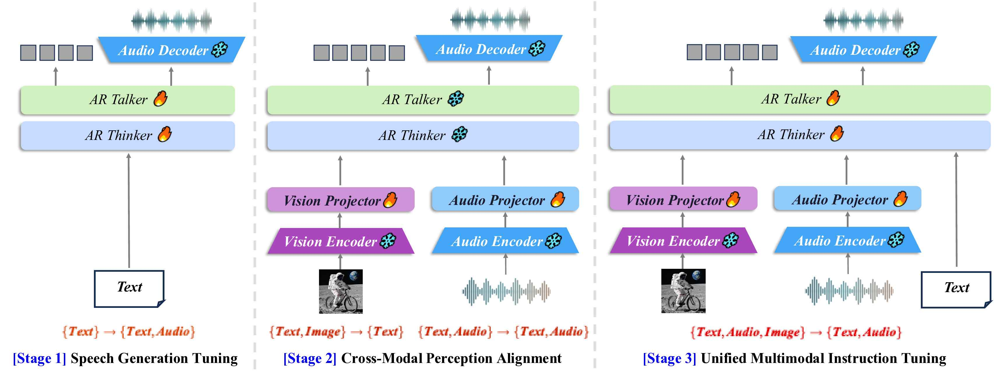
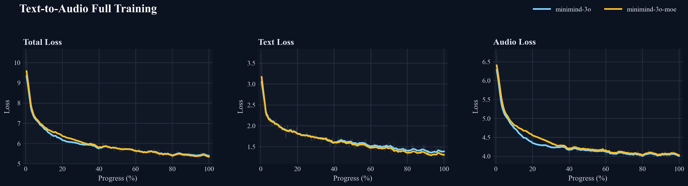
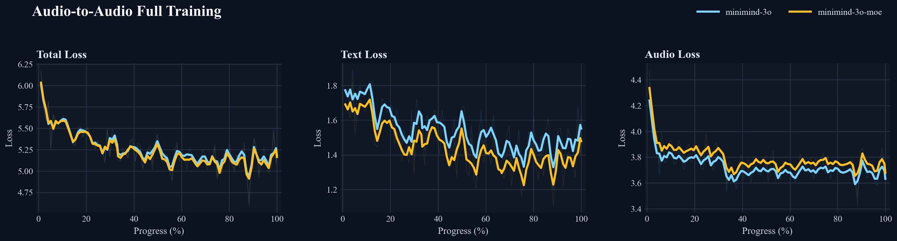

원문은 T2A 곡선에서 호환되지 않는 가중치 재개 때문에 발생한 초기 급등 구간을 제거했다고 명시합니다.

## 모델 구조

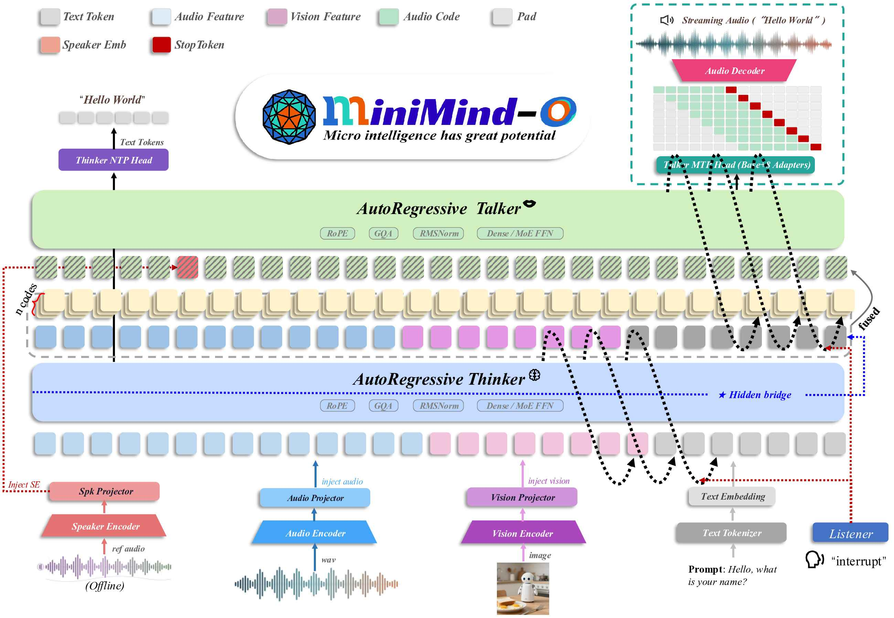

### Thinker와 멀티모달 입력

Thinker는 텍스트, 음성, 이미지를 하나의 시퀀스로 받아 의미 수준의 텍스트 답변을 생성합니다. 텍스트는 바로 언어 백본에 들어가고, 음성과 이미지는 각각 인코더와 2층 MLP Projector를 거쳐 자리표시자 위치에 주입됩니다.

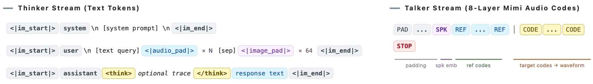

### 중간층 Bridge

Thinker에서 Talker로 넘기는 표현은 임베딩층이나 최종층이 아닌 중간층의 은닉 상태입니다. 중간층은 문맥과 모달 간 정보를 결합하면서 최종 토큰 예측에 지나치게 특화되지 않은 조건을 제공합니다.

기본 위치는 `bridge_layer = num_hidden_layers // 2 - 1`이며 설정으로 바꿀 수 있습니다.

### Talker와 MTP

Talker는 Thinker의 의미 표현을 받아 Mimi 코드북 8개의 코드를 생성합니다. MTP로 여러 코드북의 출력을 함께 예측합니다. 코드북별로 큰 임베딩과 출력층을 복제하는 대신 공통 부분을 공유하고 가벼운 어댑터를 사용해 매개변수 증가를 줄입니다.

### 시퀀스와 스트리밍

텍스트 토큰과 8개 오디오 코드 스트림이 같은 학습 샘플에 들어갑니다. 응답이 시작된 이후의 텍스트와 오디오에만 목표 손실을 적용하며 참조·조건 영역은 복원 대상에 포함하지 않습니다.

추론 중에는 텍스트를 생성하면서 지연 스케줄에 따라 오디오 코드북을 채웁니다. Mimi는 코드가 들어오는 대로 24kHz 파형을 복원하므로 답변 전체를 기다리지 않고 재생을 시작할 수 있습니다.

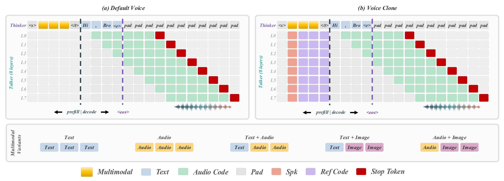

### 음색 제어와 음성 복제

참조 오디오를 음성 프롬프트로 인코딩해 Talker의 문맥 조건으로 사용합니다. 화자 임베딩을 추가해 화자 특성을 보조할 수도 있습니다. 음색을 바꿀 때마다 모델 가중치를 다시 미세 조정할 필요는 없습니다.

- 내장 음성 5개: `dylan`, `eric`, `serena`, `uncle_fu`, `vivian`.
- 미학습 평가 음성 7개: `arthur`, `chelsie`, `cherry`, `ethan`, `jennifer`, `momo`, `moon`.

음성 복제는 아직 실험적인 기능입니다. 긴 발화에서 음색, 발음, 리듬이 흔들릴 수 있습니다.

### 매개변수 집계

“0.1B”는 Thinker, Talker와 두 Projector로 이루어진 학습 가능한 백본을 가리킵니다. 외부 인코더와 코덱은 이 수치에 포함하지 않습니다. 아래 수치는 공유 임베딩을 중복 집계하지 않은 원문의 모듈별 집계입니다.

| 집계 범위 | minimind-3o | minimind-3o-moe |
|---|---:|---:|
| 학습 가능한 백본 | 113.13M | 314.89M |
| 고정된 외부 모듈 | 424.70M | 424.70M |
| 실행 시 전체 로딩 규모 | 537.83M | 739.59M |

| 모듈 | 구현·주요 설정 | 상태 및 규모(Dense / MoE) |
|---|---|---|
| Thinker | MiniMind, 8층, 은닉 차원 768 | 학습 가능, 63.91M / 198.42M |
| Talker | 독립 MiniMind 블록 4층, 코드북 헤드 8개 | 학습 가능, 47.05M / 114.30M |
| 음성 Projector | `MMAudioProjector`, 512 → 768 | 학습 가능, 0.99M |
| 비전 Projector | `MMVisionProjector`, 768 → 768 | 학습 가능, 1.18M |
| 음성 인코더 | SenseVoice-Small, 16kHz 입력 특징 | 고정, 234.00M |
| 비전 인코더 | SigLIP2 base-p32-256, 64토큰 | 고정, 94.55M |
| 음성 코덱 | Mimi, 코드북 8개, 12.5Hz, 24kHz | 고정, 96.15M |
| 화자 조건 | CAM++, 192차원 화자 벡터 | 사전 계산 |

상세 구현은 [model_omni.py](./model/model_omni.py)와 [기술 보고서](http://arxiv.org/abs/2605.03937)를 참고하세요.

## 데이터

음성은 Mimi 코드북 8개와 12.5Hz 프레임률로 저장합니다. 이미지는 256×256으로 맞춘 뒤 SigLIP2 P32로 64개 패치 토큰을 추출합니다.

주요 데이터 출처는 [VoiceAssistant-400K](https://huggingface.co/datasets/gpt-omni/VoiceAssistant-400K), [UltraChat-300K-SLAM-Omni](https://huggingface.co/datasets/worstchan/UltraChat-300K-SLAM-Omni) 등입니다. Qwen3-TTS로 다중 화자 음성을 추가 합성하고 CAM++로 화자 임베딩을 추출했습니다. I2T는 MiniMind-V의 시각 지시 데이터와 같은 출처를 따릅니다.

| 데이터셋 | 부분집합 | 입력 음성 | 출력 음성 | 용도 |
|---|---|---|---|---|
| `sft_t2a_mini` | 영어 T2A | — | 약 470.14시간 | 빠른 입문 |
| `sft_a2a_mini` | 영어 A2A | 약 74.64시간 | 약 56.60시간 | 빠른 입문 |
| `sft_t2a` | 중국어·영어 T2A | — | 약 1636.01시간 | 전체 학습 |
| `sft_a2a` | 중국어·영어 A2A | 약 1711.97시간 | 약 423.40시간 | 전체 학습 |
| `sft_i2t` | 이미지 I2T | — | — | 전체 학습 |

음성 시간은 데이터에 포함된 오디오 분량이며 GPU 학습 시간이 아닙니다. T2A의 중국어·영어·혼합 비율은 45.7% / 46.5% / 7.8%, A2A는 70.8% / 21.2% / 8.0%입니다.

## 공개 가중치

| 형식 | ModelScope | Hugging Face |
|---|---|---|
| PyTorch (`*.pth`) | [minimind-3o-pytorch](https://www.modelscope.cn/models/gongjy/minimind-3o-pytorch) | [minimind-3o-pytorch](https://huggingface.co/jingyaogong/minimind-3o-pytorch) |
| Transformers | [모델 모음](https://modelscope.cn/collections/gongjy/MiniMind-O) | [모델 모음](https://huggingface.co/collections/jingyaogong/minimind-o) |

Transformers 형식은 CLI와 WebUI에, PyTorch 원본 가중치는 학습 재현과 추가 미세 조정에 사용할 수 있습니다.

## 평가 결과와 해석

Omni 모델은 언어 백본, 음성 합성기와 목표가 달라 통일된 평가가 어렵습니다. 이 프로젝트는 작은 규모에서 재현할 수 있는 국소 실험을 중심으로 평가합니다. CER/WER는 주로 생성 음성과 목표 텍스트의 일관성을 측정하며, 음질·자연스러움·선호도를 모두 설명하는 지표는 아닙니다.

### Talker 은닉 차원 비교

| 구성 | Talker 차원 | 매개변수 | 평균 CER ↓ | 짧은 발화 ↓ | 중간 / 긴 발화 ↓ |
|---|---|---|---|---|---|
| Dense | 768 | 115.29M | **0.0897** | 0.1528 | 0.0874 / 0.0675 |
| Dense | 512 | 96.13M | 0.1745 | 0.2709 | 0.2455 / 0.0976 |
| Dense | 384 | 88.72M | 0.2767 | 0.3904 | 0.1865 / 0.4046 |
| MoE | 768 | 317.05M-A115.33M | **0.0900** | 0.2075 | 0.0533 / 0.0271 |
| MoE | 512 | 261.32M-A96.17M | 0.1265 | 0.0711 | 0.1490 / 0.1464 |
| MoE | 384 | 240.04M-A88.75M | 0.3280 | 0.3757 | 0.2777 / 0.4313 |

작은 차원은 매개변수를 줄이지만 긴 발화의 누락과 반복을 늘렸습니다. 768차원은 Thinker 폭과 같아 마지막 4개 층으로 초기화할 수 있고 비교적 안정적이었습니다. Dense와 MoE는 생성한 텍스트가 달라질 수 있으므로 구조 간 CER을 그대로 비교하기보다 같은 구조 안에서 차원 변화의 추세를 보는 것이 적절합니다.

### 음성 복제 유사도

동일한 질문에서 음성 조건만 바꾸고 CAM++ 화자 임베딩의 코사인 유사도를 측정한 결과입니다.

| 구분 | 화자 | Dense ↑ | MoE ↑ |
|---|---|---|---|
| 학습 시 사용 | dylan | 0.6997 | 0.6837 |
| 학습 시 사용 | eric | 0.5289 | 0.4232 |
| 학습 시 사용 | serena | 0.7092 | 0.7041 |
| 학습 시 사용 | uncle_fu | 0.7241 | 0.7337 |
| 학습 시 사용 | vivian | 0.5744 | 0.5888 |
| 미학습 | arthur | 0.7171 | 0.6750 |
| 미학습 | chelsie | 0.6437 | 0.6240 |
| 미학습 | cherry | 0.5689 | 0.5678 |
| 미학습 | ethan | 0.4783 | 0.4847 |
| 미학습 | jennifer | 0.4749 | 0.4003 |
| 미학습 | momo | 0.6470 | 0.5720 |
| 미학습 | moon | 0.4282 | 0.6673 |

이는 자동 참고 지표입니다. 원문은 참조 음성의 품질, 화자 임베딩의 구분력과 Talker 안정성이 중요하다고 설명하며, 충실한 제품 수준 음색 복제에는 아직 한계가 있다고 명시합니다. 실제 청취 예제는 영문 README에 있습니다.

### 영어 T2A 비교

영어 질문 20개에 `Answer briefly in one short sentence` 조건을 주고, 생성 음성을 동일한 Qwen3-ASR로 전사해 목표 텍스트와 비교했습니다.

| 응답 길이 | Mini-Omni CER/WER | Mini-Omni2 CER/WER | minimind-3o CER/WER |
|---|---|---|---|
| 15단어 이하 | 0.0195 / 0.0384 (n=8) | 0.0503 / 0.0584 (n=14) | 0.0531 / 0.0417 (n=8) |
| 16~30단어 | 0.0038 / 0.0052 (n=12) | 0.0062 / 0.0076 (n=6) | 0.1327 / 0.1420 (n=11) |
| 31~60단어 | — | — | 0.0431 / 0.0508 (n=1) |

짧은 발화에서는 Mini-Omni2에 가까웠지만 16~30단어에서 차이가 커졌습니다. 길이 구간별 샘플 수가 다르고 긴 발화는 1개뿐이므로 일반적인 영어 능력 순위로 해석할 수는 없습니다.

### 시각·음성 비교

합성 이미지 9장에 대한 영어 답변을 전사해 CER/WER를 비교한 결과입니다.

| 모델 | 매개변수 | 평균 CER ↓ | 평균 WER ↓ |
|---|---|---|---|
| Mini-Omni2 | 0.5B | 0.7609 | 0.9756 |
| minimind-3o | 0.1B | 0.8241 | 1.0293 |

자유로운 이미지 설명에는 동의어와 다양한 어순이 있으므로 이 수치는 이미지 이해의 절대 정확도를 뜻하지 않습니다. 동일한 자동 파이프라인에서의 비교 참고값입니다.

### 정성적 예제와 실시간 대화

음성 입력에서는 Thinker가 의미를 정리하고 Talker가 음성을 생성합니다. 짧은 답변이 상대적으로 안정적이며, 시각 경로는 주요 대상과 대략적인 장면을 파악하지만 수량·속성·공간 관계에서 오류가 발생할 수 있습니다.

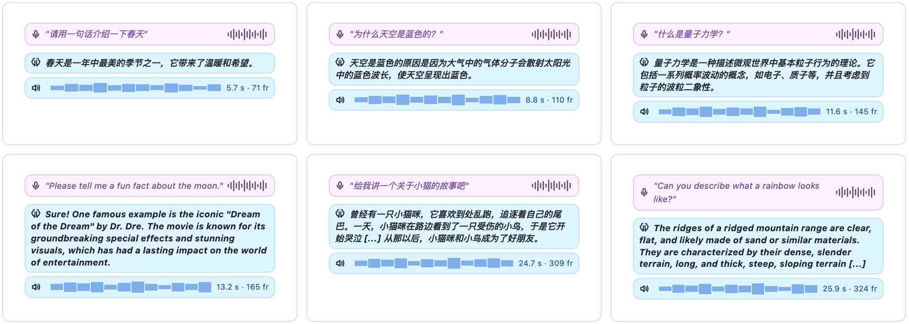
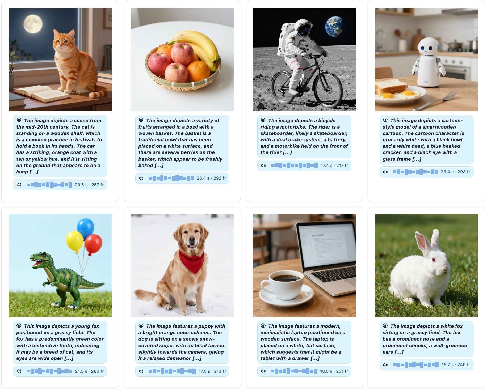
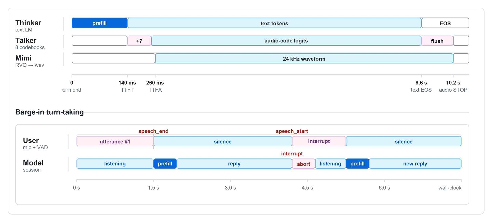

사용자가 말을 마치면 Thinker가 입력을 처리하고 Talker가 오디오 코드를 순차 생성합니다. 모델이 말하는 중 사용자가 다시 발화하면 현재 생성을 중단하고 다음 턴으로 돌아갑니다. 끼어들기 감지는 현재 단순 VAD 임계값 기반이며 의미 수준의 발화 중단 판단은 아닙니다.

## 한계와 개선 방향

긴 음성의 자연스러움, 복잡한 시각 추론, 중·장문 영어 답변과 음색 안정성은 아직 약점입니다. MoE는 같은 연산량에서의 최적 설계라기보다 용량 배분을 비교하는 실험에 가깝습니다.

후속 과제로 더 긴 문맥 내 학습 조건, 세밀한 운율 감독, 강한 비전 인코더, 안정적인 화자 조건, Bridge 위치와 MTP 코드북 인터페이스의 체계적 비교가 제시됩니다. 작은 크기로 Omni 전체 과정을 직접 재구현하고 검증할 수 있다는 점이 이 프로젝트의 주요 가치입니다.

## 기여와 참고 프로젝트

[Issues](https://github.com/jingyaogong/minimind-o/issues), [Pull Requests](https://github.com/jingyaogong/minimind-o/pulls), [기여자 목록](https://github.com/jingyaogong/minimind-o/graphs/contributors)을 참고하세요.

- [MiniMind](https://github.com/jingyaogong/minimind), [MiniMind-V](https://github.com/jingyaogong/minimind-v): 백본과 데이터.
- [Qwen2.5-Omni / Qwen3-Omni](https://github.com/QwenLM/Qwen2.5-Omni), [Mini-Omni / Mini-Omni2](https://github.com/gpt-omni/mini-omni): 설계 아이디어와 데이터.
- [SLAM-Omni](https://aclanthology.org/2025.findings-acl.115/): 데이터.
- [SenseVoice](https://arxiv.org/abs/2407.04051), [Mimi / Moshi](https://arxiv.org/abs/2410.00037): 구성 모듈.
- [vLLM-Omni](https://github.com/vllm-project/vllm-omni): 추론과 합성 데이터.

전체 참고 목록은 기술 보고서에서 확인할 수 있습니다.

## 인용

모델 구조나 실험 결과를 인용할 때는 기술 보고서를, 코드나 공개 가중치를 참조할 때는 저장소를 인용합니다.

```bibtex
@article{minimind-o-report,
    title   = {MiniMind-O Technical Report: An Open Small-Scale Speech-Native Omni Model},
    author  = {Jingyao Gong},
    journal = {arXiv preprint arXiv:2605.03937},
    year    = {2026}
}

@misc{minimind-o,
    title  = {MiniMind-O: Train a Tiny Omni Model from Scratch},
    author = {Jingyao Gong},
    year   = {2026},
    url    = {https://github.com/jingyaogong/minimind-o},
    note   = {GitHub repository, accessed 2026}
}
```

## 라이선스

이 저장소는 [Apache-2.0 License](LICENSE)로 공개됩니다.
