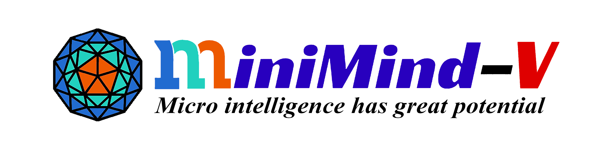
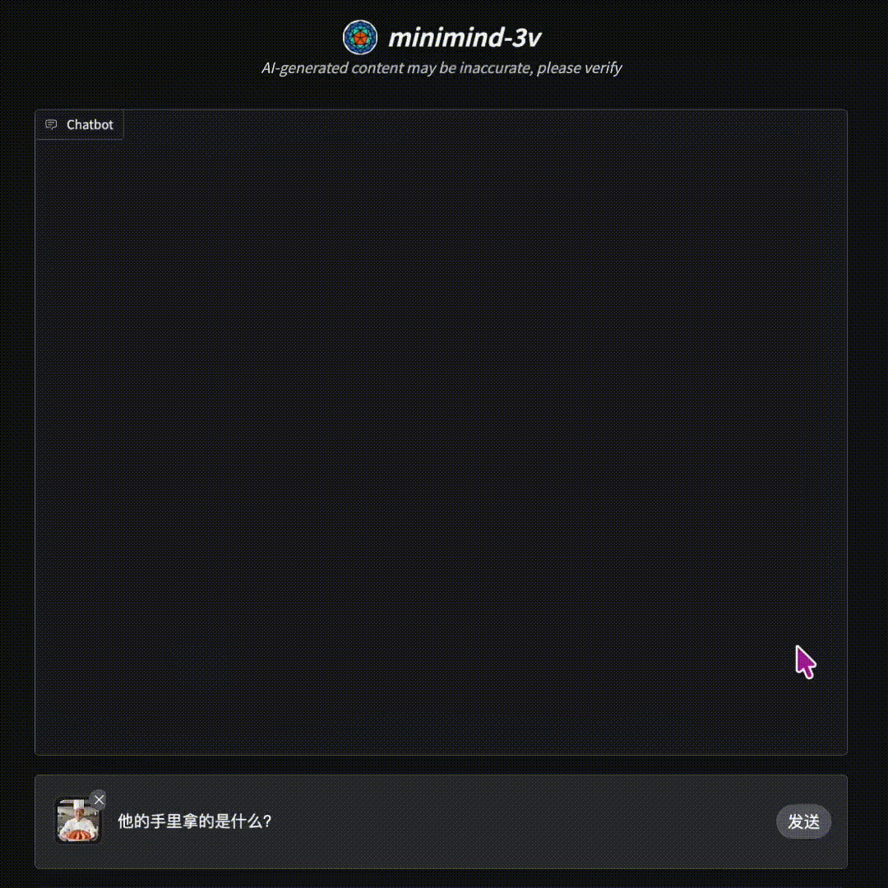
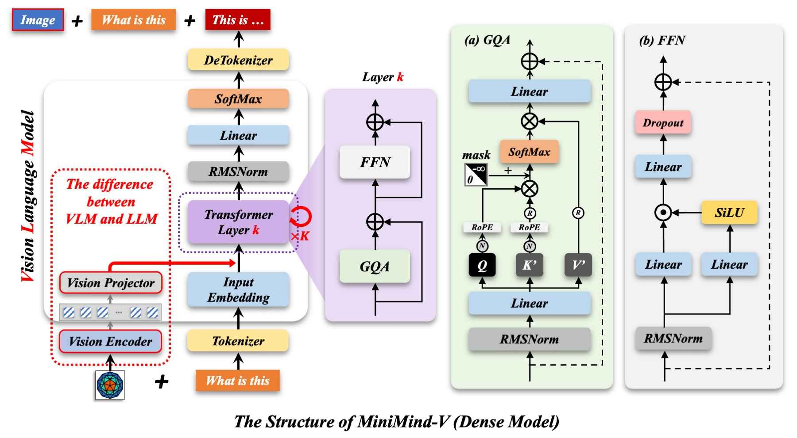
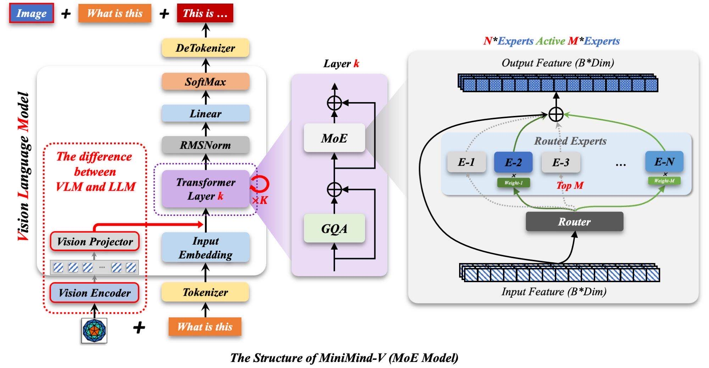
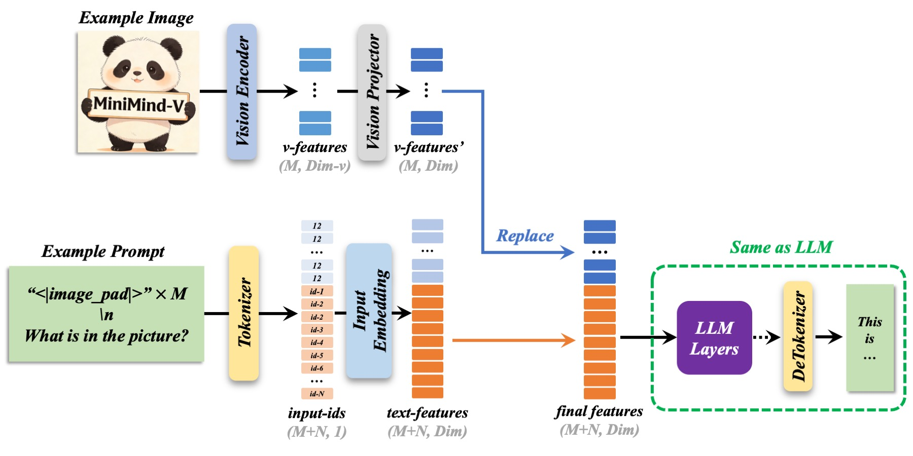
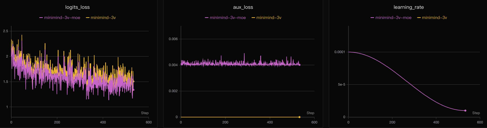
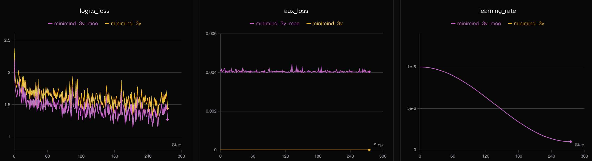

<div align="center">



# MiniMind-V — 작은 시각·언어 모델 만들기

[中文](./README.md) | [English](./README_en.md) | 한국어

[모델 모음](https://huggingface.co/collections/jingyaogong/minimind-v-67000833fb60b3a2e1f3597d) · [온라인 데모](https://www.modelscope.cn/studios/gongjy/MiniMind-V) · [소개 영상](https://www.bilibili.com/video/BV1Sh1vYBEzY)

</div>

> 이 문서는 [영문 README](./README_en.md)를 바탕으로 주요 사용법과 기술 설명을 한국어로 재구성한 안내서입니다. 전체 변경 이력과 긴 생성 예제는 영문 원문을 참고하세요. 모델 규모, 시간, 비용 및 평가 수치는 원문에 보고된 값입니다.

## 프로젝트 소개

MiniMind-V는 [MiniMind 언어 모델](../minimind/README_ko.md)에 이미지 이해 기능을 추가한 작은 시각·언어 모델(VLM)입니다. 이미지 특징을 언어 모델의 표현 공간으로 연결하는 구조와 데이터 처리, 학습, 추론 과정을 간결한 코드로 제공합니다. 같은 계열의 음성·이미지·텍스트 통합 모델은 [MiniMind-O](../minimind-o/README_ko.md)를 참고하세요.

현재 Dense 모델의 백본 규모는 약 65M입니다. 개인용 GPU에서 구조를 이해하고 직접 학습 과정을 재현하는 것이 목표입니다.

“처음부터 학습”은 무작위로 초기화한 Projector를 학습하고 LLM의 일부 층을 조정해 VLM을 구성한다는 뜻입니다. 언어 백본은 이미 학습된 MiniMind 가중치를 사용합니다. 언어 모델까지 완전히 처음부터 학습하려면 MiniMind에서 LLM 사전 학습을 먼저 수행해야 합니다.

“65M” 역시 동결된 비전 인코더를 제외한 백본 규모입니다. SigLIP2 약 95M을 포함하면 추론 시 전체 모델은 Dense 약 160M, MoE 약 294M입니다. 실제 업데이트 대상은 학습 시 고정 전략에 따라 달라집니다.

> 원문의 “2시간, 3위안”은 RTX 3090 한 장에서 SFT 1에포크에 걸린 측정 시간과 당시 GPU 대여 비용입니다. 모든 학습 단계의 총비용이나 실행 시간 보장을 의미하지 않습니다.



### 공개 모델

| 모델 | 매개변수 수 | 공개일 |
|---|---|---|
| minimind-3v-moe | 200M-A65M | 2026.04.20 |
| minimind-3v | 65M | 2026.04.20 |
| MiniMind2-V | 104M | 2025.02.20 |
| MiniMind2-Small-V | 26M | 2025.02.20 |
| minimind-v-v1-small | 27M | 2024.10.04 |
| minimind-v-v1 | 109M | 2024.10.04 |

`A65M`은 활성 매개변수 규모를 나타냅니다.

### 주요 변경 사항

- **2026-04-20:** SigLIP2 P32, 고정 256×256 입력, 64개 시각 토큰 사용. Projector에 LayerNorm을 추가하고 토큰 병합을 제거했습니다. ALLaVA-4V 기반 데이터로 변경하고 Pretrain 데이터를 SFT에 통합했습니다. SFT는 LLM 첫 층과 마지막 층을 해제하는 전략을 사용합니다.
- **2026-04-01:** 768차원·8개 층 구조, Dense/MoE 지원, SigLIP2 및 MLP 투영 도입, Parquet 데이터와 DDP·bfloat16·torch.compile 지원.
- **2025-10-24:** 가중치 불일치 수정, 학습·평가 스크립트 정리, 체크포인트 재개 지원.
- **2025-02-20:** MiniMind2-V 구조와 데이터셋 개편.
- **2024-10-05:** 최초 공개.

세부 설정은 버전별로 다릅니다. 과거 변경 이력에 등장하는 P16 인코더와 현재 P32 인코더를 혼용하지 마세요.

## 빠른 시작

아래 명령은 별도 표기가 없으면 `minimind-v/`에서 실행합니다. 이 통합 작업공간에서는 기존 디렉토리로 이동하면 됩니다.

### 환경 준비

원문의 참고 환경은 Ubuntu 20.04, CUDA 12.2, Python 3.10, RTX 3090 24GB입니다. 전체 실험 장비는 GPU 8장이지만 단일 GPU 실행도 지원합니다.

새로 저장소를 받는 경우:

```bash
git clone --depth 1 https://github.com/jingyaogong/minimind-v
cd minimind-v
pip install -r requirements.txt
```

CUDA 사용 가능 여부를 확인합니다.

```python
import torch
print(torch.cuda.is_available())
```

### 필수 리소스

```bash
# 비전 인코더
modelscope download --model gongjy/siglip2-base-p32-256-ve --local_dir ./model/siglip2-base-p32-256-ve

# VLM 학습의 초기 언어 백본
modelscope download --model gongjy/minimind-3v-pytorch llm_768.pth --local_dir ./out
```

[ModelScope 모음](https://modelscope.cn/collections/gongjy/MiniMind-V) 또는 [Hugging Face 모음](https://huggingface.co/collections/jingyaogong/minimind-v-67000833fb60b3a2e1f3597d)에서도 받을 수 있습니다. Git으로 큰 파일을 내려받는 경우 LFS가 필요합니다.

```text
minimind-v/
├── model/
│   └── siglip2-base-p32-256-ve/
├── out/
│   └── llm_768.pth
├── dataset/
└── trainer/
```

### 공개 모델 추론

```bash
modelscope download --model gongjy/minimind-3v-pytorch --local_dir ./out
python eval_vlm.py --load_from model --weight sft_vlm
```

`--load_from model`은 PyTorch 원본 가중치를 사용합니다. 다른 경로를 지정하면 Transformers 형식 모델을 읽습니다.

```bash
git clone https://huggingface.co/jingyaogong/minimind-3v
python eval_vlm.py --load_from minimind-3v
```

### 웹 화면

모델 폴더를 `scripts/` 아래에 복사한 뒤 실행합니다. 웹 데모는 가중치 파일을 포함한 하위 디렉토리를 자동 검색하며, 찾지 못하면 오류를 표시합니다.

```bash
cp -r minimind-3v ./scripts/minimind-3v
cd scripts
python web_demo_vlm.py
```

## 학습

### 데이터 준비

[Hugging Face 데이터셋](https://huggingface.co/datasets/jingyaogong/minimind-v_dataset) 또는 [ModelScope 데이터셋](https://www.modelscope.cn/datasets/gongjy/minimind-v_dataset)에서 `sft_i2t.parquet`를 받아 `dataset/`에 넣습니다.

현재 데이터는 이미지 바이트와 대화가 함께 저장된 Parquet 형식입니다. 수십만 개의 개별 이미지 파일을 압축 해제할 필요가 없습니다. `dataset/`에서 `python lm_dataset.py`를 실행하면 앞부분의 이미지·텍스트 쌍을 확인할 수 있습니다.

선택적인 Projector 사전 정렬을 수행하려면 `pretrain_i2t.parquet`도 받습니다.

```bash
wget https://hf-mirror.com/datasets/jingyaogong/minimind-v_dataset/resolve/main/pretrain_i2t.parquet -P ./dataset
```

### 권장 경로: SFT부터 실행

SFT 데이터에 Pretrain 캡션 데이터가 포함되어 있으므로 빠른 재현에서는 Pretrain을 건너뛸 수 있습니다.

```bash
cd trainer
python train_sft_vlm.py --epochs 2 --from_weight llm
```

기본 `--freeze_llm 1`은 `vision_proj`와 LLM 첫 층·마지막 층만 학습합니다. 가운데 층은 원래 언어 모델의 가중치를 유지합니다.

### 선택 경로: Pretrain 후 SFT

Projector가 시각 특징과 언어 표현을 먼저 정렬하도록 학습하려면 `trainer/`에서 다음 순서로 실행합니다.

```bash
python train_pretrain_vlm.py --epochs 2 --from_weight llm
python train_sft_vlm.py --epochs 2 --from_weight pretrain_vlm
```

결과 SFT 가중치는 `out/sft_vlm_*.pth`로 저장됩니다.

### 주요 인자

| 인자 | 의미 |
|---|---|
| `--from_weight` | 시작 가중치 접두사: `llm`, `pretrain_vlm`, `none` 등 |
| `--save_weight` | 저장할 가중치 접두사 |
| `--from_resume` | 0: 새 학습, 1: 체크포인트에서 재개 |
| `--freeze_llm 0` | LLM 전체와 Projector 학습 |
| `--freeze_llm 1` | Projector와 LLM 첫 층·마지막 층 학습 |
| `--freeze_llm 2` | Projector만 학습 |

Pretrain 기본 전략은 2, SFT 기본 전략은 1입니다. 비전 인코더는 두 단계 모두 고정합니다.

### 재개 및 다중 GPU

```bash
# trainer/에서 실행
python train_sft_vlm.py --epochs 4 --from_resume 1
```

학습은 모델 가중치와 재개용 상태를 각각 `out/`, `checkpoints/`에 저장합니다. 임시 파일을 저장한 뒤 교체하는 방식으로 중간 쓰기 실패를 줄이며, 재개 시 GPU 수가 바뀌면 단계를 자동 환산합니다.

```bash
# N을 사용할 GPU 수로 변경
torchrun --nproc_per_node N train_sft_vlm.py --epochs 2 --from_weight llm
```

학습 기록은 `--use_wandb`로 켭니다. 원문은 중국 내 네트워크 환경을 고려해 SwanLab을 wandb와 호환되는 방식으로 사용할 수 있다고 설명합니다.

### 학습 결과 확인

프로젝트 디렉토리에서 실행합니다.

```bash
python eval_vlm.py --weight sft_vlm
python eval_vlm.py --weight pretrain_vlm
```

평가할 `.pth` 가중치는 `out/`에 있어야 합니다.

## 모델 구조

MiniMind-V는 언어 백본, 동결된 비전 인코더, 시각 특징을 언어 차원으로 옮기는 Projector로 구성됩니다. 언어 모델은 MiniMind의 `llm_768.pth`를 사용하며, [model_vlm.py](./model/model_vlm.py)에서 확장 구조를 확인할 수 있습니다.




1. 이미지를 256×256 크기로 맞춥니다.
2. SigLIP2 P32가 64개 패치 토큰을 생성합니다.
3. MLP Projector가 시각 특징을 LLM의 은닉 공간으로 투영합니다.
4. 입력 텍스트의 이미지 자리표시자 임베딩을 해당 시각 벡터로 교체합니다.
5. 이후 계산은 언어 모델의 토큰 시퀀스 처리와 같은 방식으로 진행됩니다.

사용자 입력 예:

```text
<image>\n이 이미지에는 무엇이 있나요?
```

내부에서는 `<image>`를 64개의 `<|image_pad|>` 토큰으로 바꿉니다.

```text
<|image_pad|><|image_pad|>...<|image_pad|>(총 64개)\n이 이미지에는 무엇이 있나요?
```

이 자리의 텍스트 임베딩을 시각 특징으로 교체하면 이미지와 질문을 같은 시퀀스에서 처리할 수 있습니다. 별도의 텍스트 설명으로 이미지를 먼저 변환하는 과정은 필요하지 않습니다.



## 데이터 구성과 학습 설계

현재 데이터는 [ALLaVA-4V](https://huggingface.co/datasets/FreedomIntelligence/ALLaVA-4V) 계열입니다. 자연 이미지 중심의 LAION 부분집합과 문서·차트·합성 장면을 포함한 VFLAN 부분집합으로 이루어집니다. 중국어와 영어가 대체로 균형을 이룹니다.

| 구분 | 행 수 | 고유 이미지 | 주요 구성 |
|---|---|---|---|
| Pretrain | 약 1.27M | 약 640K | LAION/VFLAN의 중국어·영어 캡션 |
| SFT | 약 2.90M | 약 650K | 이미지 지시 대화, 전체 Pretrain 캡션, 일반 텍스트 대화 |

SFT의 대략적인 구성은 이미지 지시 대화 1.40M, 캡션 1.27M, 일반 텍스트 대화 230K입니다. Gemini·Claude·GPT-4o가 생성·개선한 지시 데이터도 포함합니다. 일반 텍스트 대화는 언어 능력 유지를 위해 섞으며 이미지 열에는 8×8 검은색 자리표시자 이미지를 넣습니다.

이미지는 256×256으로 변환하고 JPEG로 다시 인코딩해 Parquet에 저장합니다. 주요 열은 다음과 같습니다.

```text
conversations: JSON 문자열
image_bytes: 이미지 바이너리
```

대화 내용 예:

```json
[
  {"role": "user", "content": "<image>\n이미지를 자세히 설명해 주세요."},
  {"role": "assistant", "content": "이미지에는 ..."}
]
```

Pretrain은 약 `4e-4`의 학습률과 길이 450을 사용해 Projector만 정렬합니다. SFT는 원문 실험 설명 기준 약 `5e-6`의 학습률과 길이 768로 캡션과 지시 대화를 함께 학습합니다. 실행 시 실제 기본값은 해당 스크립트의 인자를 확인하세요.

작은 언어 백본을 이미지 중심 데이터로 모두 미세 조정하면 일반 언어 능력이 약해질 수 있습니다. 첫 층은 시각 토큰과 언어 표현의 결합을, 마지막 층은 응답 형식과 스타일을 조정하고, 가운데 층은 기존 언어 지식을 유지하도록 구성했습니다.




## 모델 가중치

| 형식 | ModelScope | Hugging Face |
|---|---|---|
| PyTorch (`*.pth`) | [minimind-3v-pytorch](https://www.modelscope.cn/models/gongjy/minimind-3v-pytorch) | [minimind-3v-pytorch](https://huggingface.co/jingyaogong/minimind-3v-pytorch) |
| Transformers | [모델 모음](https://modelscope.cn/collections/MiniMind-V-42b841dde22d41) | [모델 모음](https://huggingface.co/collections/jingyaogong/minimind-v-67000833fb60b3a2e1f3597d) |

공개 Transformers 모델은 단일 이미지 SFT를 마친 모델입니다.

## 평가와 한계

원문은 개, 우산, 자전거, 스포츠카, 슈퍼히어로, 경주차의 6개 정성적 샘플에서 두 모델 모두 주요 대상을 인식했다고 보고합니다. 이는 해당 샘플의 관찰 결과이며 일반적인 정확도 벤치마크를 의미하지 않습니다.

MoE는 배경과 물체 세부사항을 더 풍부하게 묘사하는 경향을 보였고, Dense는 더 간결하고 반복이 적었습니다. 두 모델 모두 세부 속성을 잘못 만들거나 반복하는 문제가 남아 있습니다. 전반적으로 장면의 핵심은 파악하지만 상세 정보는 부정확할 수 있습니다.

VLM의 성능은 언어 백본의 표현력에도 영향을 받습니다. 더 강한 백본은 같은 이미지·텍스트 데이터에서도 더 정확한 설명과 일관된 추론을 얻을 수 있습니다.

향후 개선 방향은 동적 해상도와 타일 인코딩, 더 강한 비전 인코더, 여러 이미지·동영상 이해, Visual Grounding입니다. 원문의 생성 예제와 비교 이미지는 [영문 README](./README_en.md)의 평가 절에서 확인할 수 있습니다.

## 기여와 참고 자료

[Issues](https://github.com/jingyaogong/minimind-v/issues)와 [Pull Requests](https://github.com/jingyaogong/minimind-v/pulls)를 통해 오류와 개선점을 공유할 수 있습니다. [전체 기여자](https://github.com/jingyaogong/minimind-v/graphs/contributors)에게 감사드립니다.

- [LLaVA](https://arxiv.org/pdf/2304.08485)
- [LLaVA-VL](https://arxiv.org/pdf/2310.03744)
- [Chinese-LLaVA-Vision-Instructions](https://huggingface.co/datasets/LinkSoul/Chinese-LLaVA-Vision-Instructions)
- [@xinyanghuang7의 다중 이미지 VLM 브랜치](https://github.com/xinyanghuang7/minimind-v/tree/hxy)

## 인용

```bibtex
@misc{minimind-v,
  title = {MiniMind-V: Train a Tiny VLM from Scratch},
  author = {Jingyao Gong},
  year = {2024},
  url = {https://github.com/jingyaogong/minimind-v},
  note = {GitHub repository, accessed 2026}
}
```

## 라이선스

이 저장소는 [Apache-2.0 License](LICENSE)로 공개됩니다.
