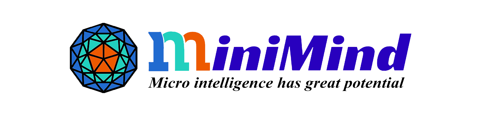
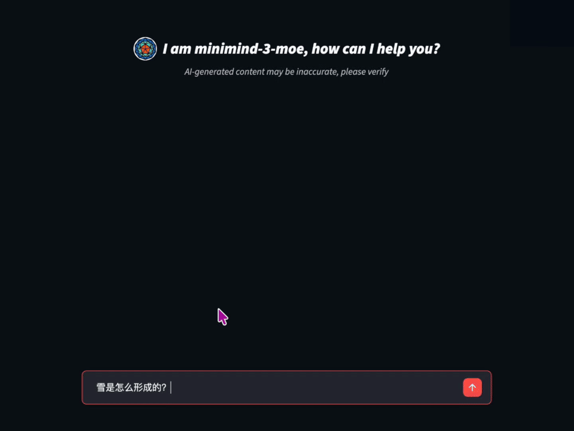
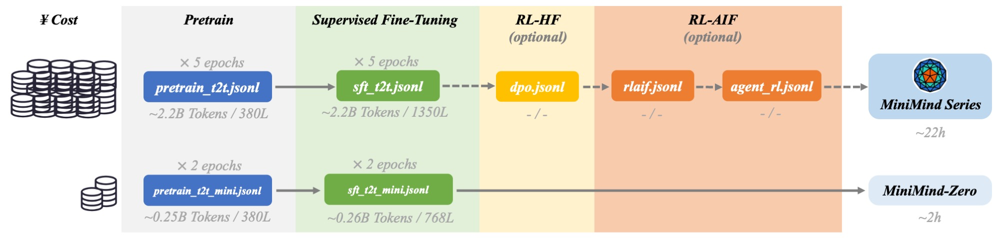
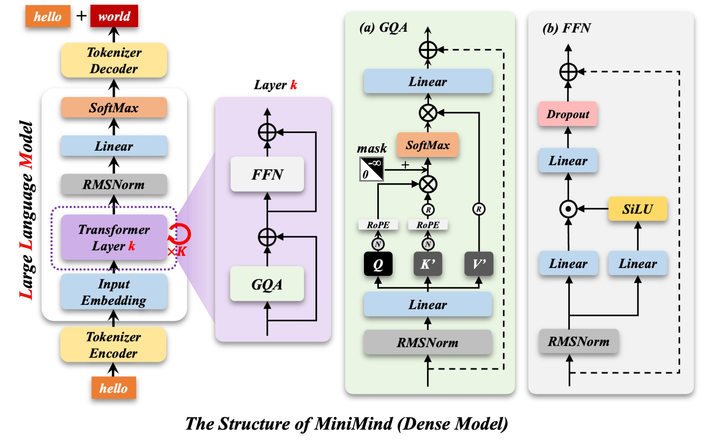
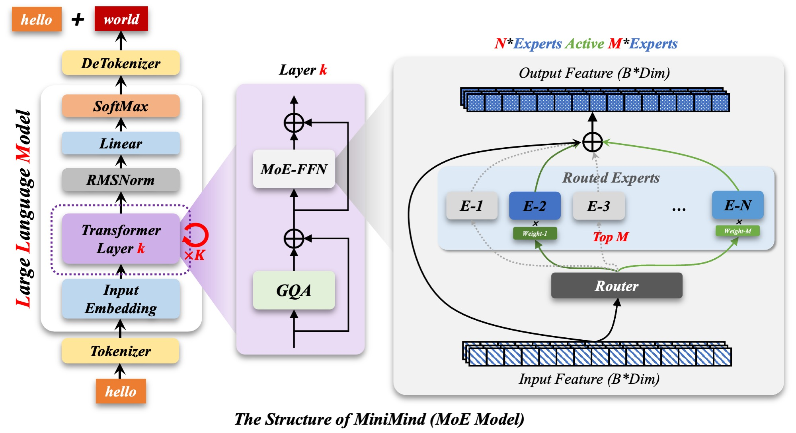
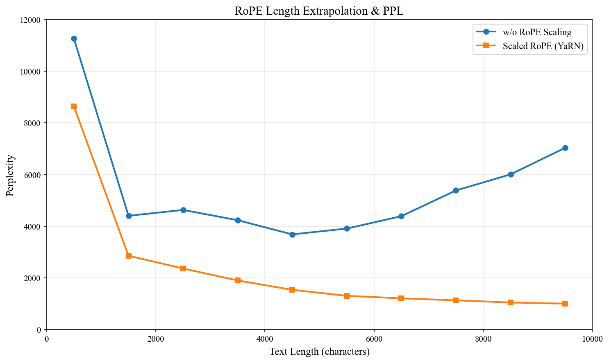

<div align="center">



# MiniMind — 작은 언어 모델을 처음부터 학습하기

[中文](./README.md) | [English](./README_en.md) | 한국어

[모델 모음](https://huggingface.co/collections/jingyaogong/minimind-66caf8d999f5c7fa64f399e5) · [온라인 데모](https://www.modelscope.cn/studios/gongjy/MiniMind) · [소개 영상](https://www.bilibili.com/video/BV12dHPeqE72)

</div>

> 이 문서는 [영문 README](./README_en.md)를 바탕으로 주요 사용법과 기술 설명을 한국어로 재구성한 안내서입니다. 전체 변경 이력, 긴 대화 예제와 배포 도구별 상세 설정은 영문 원문에서 확인할 수 있습니다. 아래 성능과 비용 수치는 원문에 보고된 결과입니다.

## 프로젝트 소개

MiniMind는 약 64M개의 매개변수를 가진 작은 언어 모델을 처음부터 학습하며 LLM의 전체 구현 과정을 이해하기 위한 프로젝트입니다. 개인용 GPU에서도 재현할 수 있도록 모델과 학습 코드를 간결하게 구성하고, 핵심 알고리즘은 고수준 학습 프레임워크에 의존하지 않고 PyTorch로 직접 구현합니다.

사전 학습부터 지도 미세 조정(SFT), LoRA, 지식 증류, 선호 최적화와 강화 학습까지 하나의 코드베이스에서 살펴볼 수 있습니다. 도구 호출, 여러 턴의 도구 사용을 학습하는 Agentic RL, 상황에 따른 사고 모드도 포함합니다.

관련 프로젝트로 이미지 이해를 위한 [MiniMind-V](../minimind-v/README_ko.md), 텍스트·음성·이미지를 다루는 [MiniMind-O](../minimind-o/README_ko.md), 확산 언어 모델과 선형 어텐션 실험이 있습니다.

> 원문의 “약 2시간, 약 3위안”은 NVIDIA RTX 3090 한 장에서 SFT 1에포크를 수행한 측정 시간과 해당 GPU 대여 비용을 뜻합니다. 모든 학습 단계를 합친 비용이나 모든 환경에서 보장되는 실행 시간이 아닙니다.



### 제공 기능

- Dense 및 MoE 모델 구현과 Qwen3 계열 생태계와의 형식 호환.
- 어휘 크기 6,400의 토크나이저와 토크나이저 학습 예제.
- 사전 학습, SFT, LoRA, 지식 증류, DPO, PPO, GRPO, CISPO 및 Agentic RL.
- `<tool_call>`, `<tool_response>`, `<think>` 등의 템플릿 토큰과 도구 호출.
- DDP 다중 GPU 학습, 체크포인트 저장·재개, wandb/SwanLab 기록.
- Transformers 형식 변환 및 SGLang, vLLM, llama.cpp, Ollama 등과의 연동.
- OpenAI API 형식과 호환되는 경량 서버 및 Streamlit 채팅 화면.
- YaRN을 이용한 RoPE 길이 외삽과 외부 벤치마크 평가.

### 공개 모델

| 모델 | 매개변수 수 | 공개일 |
|---|---|---|
| minimind-3 | 64M | 2026.04.01 |
| minimind-3-moe | 198M-A64M | 2026.04.01 |
| minimind2-small | 26M | 2025.04.26 |
| minimind2-moe | 145M | 2025.04.26 |
| minimind2 | 104M | 2025.04.26 |
| minimind-v1-small | 26M | 2024.08.28 |
| minimind-v1-moe | 4×26M | 2024.09.17 |
| minimind-v1 | 108M | 2024.09.01 |

`A64M`은 토큰 처리 시 활성화되는 매개변수 규모를 나타냅니다. 이전 세대 모델의 설정은 현재 기본 설정과 다를 수 있습니다.

## 빠른 시작

아래 명령은 별도 표기가 없으면 `minimind/` 디렉토리에서 실행합니다. 이 통합 작업공간에서는 이미 존재하는 `minimind/`로 이동하면 됩니다.

### 환경 준비

원문의 참고 환경은 Ubuntu 20.04, CUDA 12.2, Python 3.10.16, RTX 3090 24GB입니다. 전체 실험 장비는 GPU 8장이지만 단일 GPU 실행도 지원합니다.

새로 저장소를 내려받는 경우:

```bash
git clone --depth 1 https://github.com/jingyaogong/minimind
cd minimind
pip install -r requirements.txt
```

GPU를 사용할 수 있는지 확인합니다.

```python
import torch
print(torch.cuda.is_available())
```

장치에 따라 CPU나 MPS로도 실행할 수 있지만 학습 속도와 호환성은 달라집니다.

### 공개 모델로 추론하기

ModelScope 또는 Hugging Face 중 한 가지 방법으로 모델을 받습니다.

```bash
modelscope download --model gongjy/minimind-3 --local_dir ./minimind-3
```

```bash
git clone https://huggingface.co/jingyaogong/minimind-3
```

Transformers 형식 모델:

```bash
python eval_llm.py --load_from ./minimind-3
```

PyTorch 원본 가중치는 해당 파일을 `out/`에 넣은 뒤 사용합니다.

```bash
python eval_llm.py --load_from ./model --weight full_sft
```

`--weight`는 `pretrain`, `full_sft` 같은 가중치 파일 이름의 접두사입니다.

### 웹 화면

Transformers 형식 모델 폴더를 `scripts/` 아래에 먼저 복사해야 합니다. 웹 데모는 가중치를 포함한 하위 폴더를 자동으로 검색합니다.

```bash
cp -r minimind-3 ./scripts/minimind-3
cd scripts
streamlit run web_demo.py
```

필요하면 `pip install streamlit`으로 Streamlit을 설치합니다.

### 최소 학습 과정

[ModelScope 데이터셋](https://www.modelscope.cn/datasets/gongjy/minimind_dataset/files) 또는 [Hugging Face 데이터셋](https://huggingface.co/datasets/jingyaogong/minimind_dataset/tree/main)에서 다음 파일을 받아 `dataset/`에 넣습니다.

- `pretrain_t2t_mini.jsonl`: 빠른 재현용 사전 학습 데이터.
- `sft_t2t_mini.jsonl`: 빠른 재현용 대화 미세 조정 데이터.

먼저 사전 학습을 실행하고, 완료되면 SFT를 실행합니다.

```bash
cd trainer
python train_pretrain.py
python train_full_sft.py
```

기본 차원이 768이면 결과는 각각 `out/pretrain_768.pth`, `out/full_sft_768.pth`로 저장됩니다. 학습 후 프로젝트 디렉토리로 돌아와 확인합니다.

```bash
cd ..
python eval_llm.py --weight full_sft
```

### 체크포인트와 다중 GPU

`trainer/`에서 기존 명령에 `--from_resume 1`을 추가하면 중단된 학습을 재개합니다.

```bash
python train_pretrain.py --from_resume 1
python train_full_sft.py --from_resume 1
```

재개 파일은 `checkpoints/<가중치이름>_<차원>_resume.pth` 형식이며 모델, 옵티마이저, 학습 진행 상태 등을 담습니다. GPU 수가 바뀌면 단계를 환산하며, wandb 실행 기록도 이어갈 수 있습니다.

다중 GPU에서는 `N`을 사용할 GPU 수로 바꿉니다.

```bash
torchrun --nproc_per_node N train_pretrain.py
```

`--use_wandb`로 학습 기록을 켤 수 있습니다. 원문은 중국 내 네트워크 환경을 고려해 기본 시각화 도구로 SwanLab을 사용한다고 설명합니다. 실제 사용 라이브러리는 각 스크립트의 import를 확인하세요.

## 데이터와 토크나이저

### 토크나이저

토크나이저는 텍스트를 토큰 ID로 바꾸고 다시 복원합니다. MiniMind의 어휘 크기는 6,400으로, 작은 모델에서 임베딩과 출력층이 차지하는 매개변수를 줄이기 위한 선택입니다.

`trainer/train_tokenizer.py`는 학습 예제로 제공됩니다. 어휘나 분할 규칙을 바꾸면 기존 가중치와 입력 형식의 호환성이 달라지므로, 기존 모델을 사용할 때는 제공된 토크나이저를 유지하는 편이 좋습니다. 토크나이저가 다른 모델의 토큰별 PPL을 직접 비교하기는 어렵고, 원문은 BPB(Bits Per Byte) 같은 지표도 소개합니다.

### 데이터 파일

| 파일 | 원문 기준 크기 | 용도 |
|---|---|---|
| `pretrain_t2t_mini.jsonl` | 1.2GB | 빠른 사전 학습 |
| `pretrain_t2t.jsonl` | 10GB | 전체 사전 학습 |
| `sft_t2t_mini.jsonl` | 1.6GB | 빠른 SFT |
| `sft_t2t.jsonl` | 14GB | 전체 SFT |
| `dpo.jsonl` | 53MB | 선호 쌍을 이용한 DPO |
| `rlaif.jsonl` | 24MB | PPO·GRPO·CISPO |
| `agent_rl.jsonl` | 86MB | 여러 턴의 도구 사용 학습 |
| `agent_rl_math.jsonl` | 18MB | 검증 가능한 수학·도구 사용 학습 |

전체 파일을 복제할 필요 없이 필요한 데이터만 내려받으면 됩니다. 기본 재현은 mini 조합, 전체 모델 재현은 `pretrain_t2t` → `sft_t2t` → `rlaif/agent_rl` 조합을 사용합니다.

사전 학습 데이터는 한 줄에 하나의 JSON 객체를 저장합니다.

```json
{"text": "Transformer는 자기 어텐션으로 문맥 관계를 학습합니다."}
```

SFT는 여러 턴의 대화를 사용합니다.

```json
{"conversations": [{"role": "user", "content": "안녕"}, {"role": "assistant", "content": "안녕하세요!"}]}
```

현재 SFT 데이터에는 도구 호출과 추론 관련 샘플도 포함되어 별도 도구 호출 SFT가 항상 필요한 것은 아닙니다. 데이터 출처에는 Craftsman, Magpie-Align, R1-Distill-SFT, COIG, Step-3.5-Flash-SFT 및 모델 합성 데이터 등이 포함됩니다. 코드의 라이선스와 별개로 각 원천 데이터의 이용 조건을 확인해야 합니다.

DPO는 같은 질문에 대한 선호 응답과 비선호 응답을 사용합니다.

```json
{
  "chosen": [{"role": "user", "content": "질문"}, {"role": "assistant", "content": "선호 응답"}],
  "rejected": [{"role": "user", "content": "질문"}, {"role": "assistant", "content": "비선호 응답"}]
}
```

다른 RL 데이터는 대체로 SFT와 같은 대화 형식이며, 마지막 assistant 응답을 rollout에서 생성하도록 비워 둡니다.

`max_seq_len`은 문자 수가 아닌 **토큰 수**입니다. 원문은 중국어 약 1.5~1.7자/토큰, 영어 약 4~5자/토큰을 참고치로 제시합니다. 한국어에 그대로 적용할 수 있는 수치는 아닙니다. 길이를 너무 크게 잡으면 패딩 계산이 늘고, 너무 작게 잡으면 중요한 내용이 잘릴 수 있습니다.



## 모델 구조

MiniMind-3는 Decoder-only Transformer입니다. [모델 소스](./model/model_minimind.py)에서 설정과 구현을 확인할 수 있습니다.

- Pre-Norm과 RMSNorm으로 각 블록의 입력을 정규화합니다.
- MLP에는 SwiGLU를 사용합니다.
- RoPE로 위치 정보를 반영하고 YaRN 외삽을 지원합니다.
- 기본 구성은 8개 레이어, 은닉 차원 768, Query 헤드 8개와 KV 헤드 4개입니다.
- 위치 설정은 `max_position_embeddings=32768`, `rope_theta=1e6`입니다.

MoE 버전은 MLP를 전문가 구조로 확장합니다. 기본값은 전문가 4개와 top-1 라우팅이며 공유 전문가는 사용하지 않습니다. 전문가별 토큰 분배와 개별 연산에는 실행 오버헤드가 있으므로 활성 매개변수 수만으로 학습 속도를 판단하기 어렵습니다. 원문은 현재 PyTorch 구현의 MoE가 Dense보다 약 50% 느리다고 보고합니다.




| 모델 | 매개변수 | 어휘 크기 | 레이어 | 은닉 차원 | KV / Query 헤드 |
|---|---|---|---|---|---|
| minimind-3 | 64M | 6400 | 8 | 768 | 4 / 8 |
| minimind-3-moe | 198M-A64M | 6400 | 8 | 768 | 4 / 8 |
| minimind2-small | 26M | 6400 | 8 | 512 | 2 / 8 |
| minimind2-moe | 145M | 6400 | 8 | 640 | 2 / 8 |
| minimind2 | 104M | 6400 | 16 | 768 | 2 / 8 |

작은 모델에서는 폭과 깊이의 배분도 성능에 영향을 줍니다. 현재 768×8 구성은 학습 속도, 표현력, 안정성 사이의 절충입니다. 더 깊고 좁은 구성이 유리한 경우도 있지만 폭을 지나치게 줄이면 표현 병목이 발생할 수 있습니다.

## 추가 학습 방법

다음 학습 명령은 `trainer/`에서 실행합니다.

### 지식 증류

교사의 생성 답변을 정답으로 사용하는 블랙박스 증류와, 교사 모델의 토큰 확률 분포까지 사용하는 화이트박스 증류를 구분합니다. `train_distillation.py`는 교사·학생 모델을 함께 불러와 CE와 KL 손실을 혼합하는 화이트박스 증류 예제입니다.

```math
\mathcal{L}=\alpha\mathcal{L}_{CE}+(1-\alpha)T^2\mathrm{KL}(p_t^T\parallel p_s^T)
```

```bash
python train_distillation.py
```

### LoRA

LoRA는 원래 가중치를 고정하고 저랭크 행렬로 이루어진 추가 경로만 학습합니다. 구현은 [model_lora.py](./model/model_lora.py)와 [train_lora.py](./trainer/train_lora.py)에 있습니다.

```bash
python train_lora.py
```

학습 후 `minimind/`에서 기본 모델과 LoRA 가중치를 함께 사용합니다. 기본 모델은 LoRA 학습 때 사용한 것과 일치해야 합니다.

```bash
python eval_llm.py --weight full_sft --lora_weight lora_medical
```

가중치 병합과 형식 변환은 [convert_model.py](./scripts/convert_model.py)의 관련 함수를 참고합니다.

### 도구 호출과 사고 모드

모델은 `<tool_call>...</tool_call>` 형식으로 도구 실행을 요청하고, `<tool_response>`로 반환된 결과를 이용해 응답할 수 있습니다. 도구 호출을 생성하는 것과 실제 도구를 실행하는 것은 구분되며, 실행은 클라이언트나 rollout 코드가 담당합니다.

`<think>...</think>`는 사고 구간을 표시하며 추론 시 `open_thinking` 설정을 사용할 수 있습니다. 세부 입력 템플릿과 긴 예제는 영문 README의 Tool Calling 및 Adaptive Thinking 절을 참고합니다.

### 강화 학습

| 방식 | 주요 신호 | 특징 | 실행 스크립트 |
|---|---|---|---|
| DPO | 정적 선호 응답 쌍 | 별도 보상·가치 모델 학습 없이 선호 최적화 | `train_dpo.py` |
| PPO | 보상과 Critic의 가치 추정 | GAE 및 비율 클리핑 사용 | `train_ppo.py` |
| GRPO | 같은 질문에 대한 응답 그룹의 상대 보상 | 별도 Critic 없이 그룹 기준선 사용 | `train_grpo.py` |
| CISPO | 상대 보상과 클리핑된 중요도 가중치 | 클리핑 가중치와 로그 확률을 결합 | `train_grpo.py --loss_type cispo` |
| Agentic RL | 도구 실행 결과, 정답 검증, 형식 및 보상 점수 | 여러 턴 rollout과 지연 보상 | `train_agent.py` |

```bash
python train_dpo.py
python train_ppo.py
python train_grpo.py
python train_grpo.py --loss_type cispo
python train_agent.py
```

위 명령은 각각 선택적으로 실행하는 실험입니다. 필요한 데이터와 모델, 메모리 요구량은 해당 스크립트의 인자를 확인하세요. 모든 선택 단계를 순서대로 실행해야 하는 것은 아닙니다.

원문의 RLAIF 절은 보상 모델 외에도 규칙, 정답 검증, 도구 결과 같은 자동 피드백을 넓게 다룹니다. 검증 가능한 보상을 사용하는 RLVR과 좁은 의미의 AI 피드백은 같은 개념이 아닙니다.

SGLang을 rollout 엔진으로 사용할 때는 먼저 서버를 실행하고 학습 스크립트에서 엔진을 지정합니다.

```bash
python -m sglang.launch_server --model-path ./minimind-3 --attention-backend triton --host 0.0.0.0 --port 8998
```

```bash
python train_agent.py --rollout_engine sglang --sglang_base_url http://localhost:8998 --sglang_shared_path ./ckpt_mm --data_path ../dataset/agent_rl_math.jsonl --use_wandb
```

서버의 모델 경로는 실행 위치를 기준으로 지정합니다.

### 학습 비용 참고

| 모델 | mini 사전 학습 | mini SFT | 도구 호출 학습 | RLAIF |
|---|---|---|---|---|
| minimind-3 | 약 1.21시간 / 1.57위안 | 약 1.10시간 / 1.43위안 | 약 0.9시간 / 1.17위안 | 약 1.1시간 / 1.43위안 |
| minimind-3-moe | 약 1.69시간 / 2.20위안 | 약 1.54시간 / 2.00위안 | 약 1.26시간 / 1.64위안 | 약 1.54시간 / 2.00위안 |

원문 실험의 참고값이며 데이터, 설정, 장비와 대여 요금에 따라 달라집니다.

## 가중치와 평가

PyTorch 가중치: [ModelScope](https://www.modelscope.cn/models/gongjy/minimind-3-pytorch) · [Hugging Face](https://huggingface.co/jingyaogong/minimind-3-pytorch)

Transformers 가중치: [ModelScope 모음](https://www.modelscope.cn/collections/MiniMind-b72f4cfeb74b47) · [Hugging Face 모음](https://huggingface.co/collections/jingyaogong/minimind-66caf8d999f5c7fa64f399e5)

기본 파일 이름은 `pretrain_{hidden_size}.pth`, `full_sft_{hidden_size}.pth`, `dpo_{hidden_size}.pth`, `ppo_actor_{hidden_size}.pth`, `grpo_{hidden_size}.pth`, `agent_{hidden_size}.pth` 등입니다. MoE는 `.pth` 앞에 `_moe`가 붙습니다. 모든 실험 단계의 가중치가 별도로 공개·유지되는 것은 아닙니다.

### 길이 외삽

```bash
python eval_llm.py --weight full_sft --inference_rope_scaling
```

YaRN은 학습 길이를 넘어선 위치 인코딩을 다루는 데 도움을 줍니다. 위치 설정의 최대 길이 자체가 그 길이에서의 추론 능력을 보장하지는 않습니다.



### 객관적 평가

원문은 [lm-evaluation-harness](https://github.com/EleutherAI/lm-evaluation-harness)를 이용해 C-Eval, CMMLU, ARC-Easy, PIQA, OpenBookQA, HellaSwag, Social-IQa를 평가합니다.

| 모델 | 매개변수 | C-Eval / CMMLU | ARC / PIQA / OBQA / HellaSwag / SIQA |
|---|---|---|---|
| minimind-3 | 64M | 24.89 / 25.38 | 28.49 / 50.65 / 23.60 / 28.28 / 34.19 |
| minimind-3-moe | 198M | 25.48 / 24.32 | 27.74 / 50.71 / 26.20 / 27.43 / 34.03 |
| minimind-3-exam | 64M | 30.98 / 26.12 | 35.61 / 56.26 / 24.20 / 28.40 / 34.19 |

선다형 평가는 보통 자유 생성 답변 대신 각 선택지의 조건부 로그 확률을 비교합니다. 작은 점수 차이는 테스트셋 크기에 따른 표준 오차를 고려해야 합니다. 원문은 OBQA에서 약 5점 미만, C-Eval·PIQA·SIQA에서 약 3점 미만 차이를 과도하게 해석하지 않도록 설명합니다.

`minimind-3-exam`은 더 큰 기반 모델이 아니라 선다형 입력 형식을 맞추는 LoRA를 병합한 버전입니다. 원문은 해당 정렬 데이터와 보고한 7개 평가셋 사이에 샘플 중복이 없다고 설명합니다. 상세 비교와 정성적 대화 결과는 영문 원문을 참고하세요. RL 보상 상승은 일반 지식이나 모든 작업 성능의 상승을 보장하지 않습니다.

## 배포와 연동

### 모델 변환 및 API 서버

[scripts/convert_model.py](./scripts/convert_model.py)는 PyTorch와 Transformers 사이의 변환을 제공합니다. 공개 Transformers 모델을 준비한 뒤 경량 API 서버를 실행할 수 있습니다.

```bash
cd scripts
python serve_openai_api.py
```

별도 터미널에서 `scripts/chat_api.py`로 확인합니다. API는 `reasoning_content`, `tool_calls`, `open_thinking`을 지원하여 FastGPT, OpenWebUI, Dify 같은 외부 UI와 연결할 수 있습니다.

```bash
curl http://localhost:8998/v1/chat/completions \
  -H "Content-Type: application/json" \
  -d '{"model":"model-identifier","messages":[{"role":"user","content":"세상에서 가장 높은 산은 무엇인가요?"}],"temperature":0.7,"max_tokens":1024,"stream":true,"open_thinking":true}'
```

### 외부 추론 엔진

```bash
# vLLM
vllm serve /path/to/model --model-impl transformers --served-model-name "minimind" --port 8998

# Ollama
ollama run jingyaogong/minimind-3
```

원문에는 llama.cpp의 GGUF 변환, Ollama 모델 등록·배포, MNN 양자화 내보내기 절차도 있습니다. 해당 도구에 필요한 파일 수정과 설정은 [영문 README](./README_en.md)의 배포 절을 참고하세요.

## 기여와 인용

오류 제보와 개선 제안은 [Issues](https://github.com/jingyaogong/minimind/issues), 코드 기여는 [Pull Requests](https://github.com/jingyaogong/minimind/pulls)를 이용할 수 있습니다. [기여자 목록](https://github.com/jingyaogong/minimind/graphs/contributors)과 참고 프로젝트 전체 목록은 원문에 있습니다.

연구나 작업에서 프로젝트를 활용했다면 다음과 같이 인용할 수 있습니다.

```bibtex
@misc{minimind,
  title = {MiniMind: Train a Tiny LLM from Scratch},
  author = {Jingyao Gong},
  year = {2024},
  url = {https://github.com/jingyaogong/minimind},
  note = {GitHub repository}
}
```

## 라이선스

이 프로젝트는 [Apache License 2.0](LICENSE)으로 공개됩니다.
